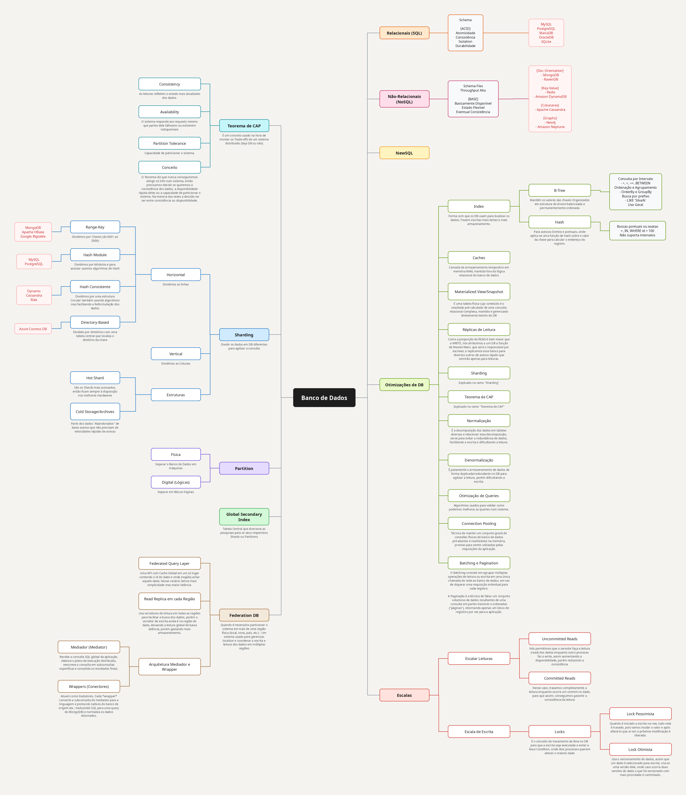
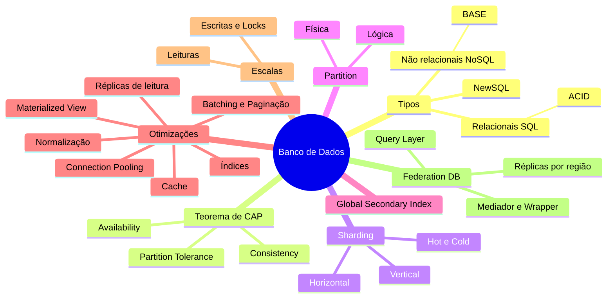

# Estudo de Bancos de Dados

Minhas anotações sobre bancos de dados: tipos de banco, como eles escalam e o que dá pra fazer quando a consulta começa a ficar lenta.

Comecei tudo num mapa mental no FigCraft e fui completando conforme estudava. Este repositório guarda o mapa e uma versão em texto de cada ramo, que é mais fácil de ler e de revisar depois.



## Como está organizado

```
estudo-bancos-de-dados/
├── mapa-mental/
│   ├── mapa-mental.png          # o mapa inteiro em imagem
│   └── Bancodedados.figcraft    # arquivo original, abre no FigCraft
└── notas/
    ├── 01-tipos-de-banco.md
    ├── 02-teorema-cap.md
    ├── 03-sharding-e-particionamento.md
    ├── 04-otimizacoes.md
    ├── 05-escalando-leituras-e-escritas.md
    └── 06-federation-db.md
```

## Notas

| # | Assunto | O que tem lá |
|---|---------|--------------|
| 1 | [Tipos de banco](notas/01-tipos-de-banco.md) | SQL x NoSQL, ACID x BASE, exemplos de cada um |
| 2 | [Teorema de CAP](notas/02-teorema-cap.md) | Consistency, Availability, Partition Tolerance e por que não dá pra ter os três |
| 3 | [Sharding e particionamento](notas/03-sharding-e-particionamento.md) | Sharding horizontal e vertical, estratégias de chave, hot e cold shards, Global Secondary Index |
| 4 | [Otimizações](notas/04-otimizacoes.md) | Índices (B-Tree e Hash), cache, materialized view, réplicas, normalização, pooling, batching |
| 5 | [Escalando leituras e escritas](notas/05-escalando-leituras-e-escritas.md) | Uncommitted x Committed reads, locks pessimista e otimista |
| 6 | [Federation DB](notas/06-federation-db.md) | Dados em várias regiões, query layer, réplicas regionais, mediador e wrappers |

A ordem é a que eu recomendo ler. Os tipos de banco e o CAP aparecem em quase todo o resto.

## Visão geral rápida

O mesmo mapa, resumido (o GitHub desenha o diagrama sozinho):



## Abrindo o mapa original

O arquivo `mapa-mental/Bancodedados.figcraft` abre no FigCraft. Ele tem duas páginas: **Page 1**, com o rascunho do começo, e **Mapa mental**, que é a versão organizada.

## O que ainda falta

- [ ] Escrever sobre **NewSQL** (por enquanto é só o nome no mapa)
- [ ] Completar o **Sharding vertical** com exemplos
- [ ] Juntar exemplos de SQL de verdade nas notas de índice
